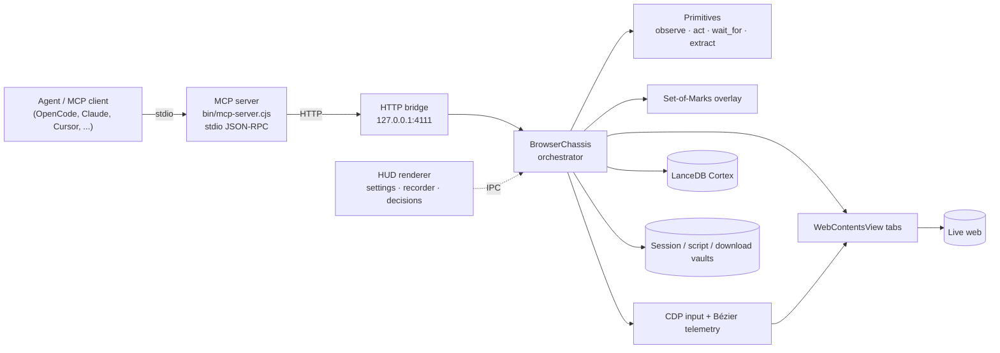
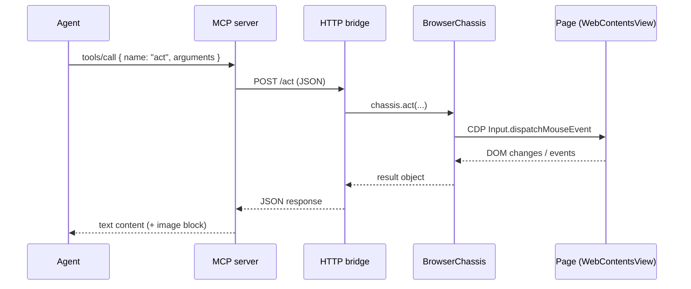

# Codebase Lowdown

**Hyperbolic Gateway — architecture, structure and findings**
Version 1.4.5 · 22 October 2026

This document explains what the code does, how the parts connect, and what to fix next. It uses short
sentences and simple terms. It is a map, not a tutorial. For install and build steps, see
[`BUILDING.md`](./BUILDING.md). For the tool list, see the [README](../README.md).

---

## 1. What this program does

Hyperbolic Gateway is a desktop application. It runs a real Chromium browser on the local machine.
An AI agent controls that browser through the Model Context Protocol (MCP).

The agent does not use a remote browser. It does not use a headless browser. The browser is visible, and
it keeps cookies, tabs, downloads and memory between sessions.

The program has two processes:

1. **The Electron app.** It owns the window, the browser tabs, the HUD, the database and the local
   files. It listens on `http://127.0.0.1:4111`.
2. **The MCP server.** Each agent client starts its own copy (`bin/mcp-server.cjs`). It speaks JSON-RPC
   over `stdin`/`stdout` and forwards each tool call to the Electron app over HTTP.


The program also has one optional decision path. If a decision model is configured, the agent can call
`decide` or `drive`. These tools ask a model for a typed choice. The model never writes text for the
page. The agent supplies text.

---

## 2. System map



The bridge is the only control surface. The MCP server is stateless. All state lives in the Electron app.

---

## 3. Process and window model

| Part | Process | Job |
| :--- | :--- | :--- |
| `src/main/index.ts` | Electron main | Window, IPC, bridge start, updater, recording service |
| `src/preload/index.ts` | Preload | Safe `window.electronAPI` surface for the HUD |
| `src/renderer/main.ts` | HUD renderer | Controls, logs, settings, MCP client snippets |
| `src/renderer/recording.ts` | HUD renderer | Desktop capture and VP9/WebM encoding |
| `WebContentsView` per tab | Chromium renderer | The real pages the agent drives |
| `src/mcp/bridge-server.ts` | Separate Node process | stdio MCP server; forwards to the bridge |

The HUD and the web pages are different renderers. The HUD is not a web page. A tool call cannot reach
`window.electronAPI`. This separation is deliberate: page JavaScript (`evaluate_javascript`) must not be
able to change settings or read local files.

---

## 4. Call path



Rules that the code depends on:

- `stdout` carries JSON-RPC only. Logs go to `data/logs/mcp-server.log`.
- `stderr` is a short boot banner by default. A client that does not read `stderr` must not be able to
  block the server. See [`HANDOFF_ORCHA_MCP_STDERR.md`](./HANDOFF_ORCHA_MCP_STDERR.md).
- The bridge binds to `127.0.0.1` only.
- `KUANG_BRIDGE_PORT` changes the port. `KUANG_BRIDGE_URL` points the MCP server at it.
- `KUANG_BRIDGE_TIMEOUT_MS` caps one bridge round-trip (default 300 000 ms).

---

## 5. Directory map

```
src/
  main/            Electron main process
    index.ts       entry point, window, IPC, service wiring
    browser-chassis.ts   central orchestrator (1 865 lines)
    http-bridge.ts       HTTP routes (1 162 lines)
    primitives/          observe, act, wait_for, extract, ...
    marks/               Set-of-Marks overlay and targeting
    telemetry/           Bézier pointer, typing, fingerprints
    tabs/                multi-tab WebContentsView manager
    cortex/              LanceDB memory and embedder
    harvester/           Readability + Turndown markdown
    shield/              consent/GDPR dismissal
    hil/                 human-in-the-loop requests
    decide/              optional typed decision client + guard
    drive/               observe → decide → act loop
    recording/           timelapse capture service
    downloads/           download routing and parsing
    session/             cookie/storage vaults
    scripts/             script vault
    network/             CDP network + stream capture
    search/ crawl/ research/ prerender/ snapshots/ llm/ updates/ tray/ menu/ utils/
  mcp/             MCP server and tool catalog
    tools-catalog.ts     tool schemas, endpoints, formatters
    bridge-server.ts     stdio server, resources, dispatch
  preload/         contextBridge API
  renderer/        HUD (main.ts) and timelapse encoder (recording.ts)
  shared/          shared types and version

public/            welcome manual, assets, icons
scripts/           build, release, tests, one-off tools
docs/              architecture notes, field notes, this file
bin/               bundled MCP server (unpacked in installers)
```

All 46 TypeScript files are reachable from four entry points: `src/main/index.ts`,
`src/preload/index.ts`, `src/renderer/main.ts` and `src/mcp/bridge-server.ts`. There are no unreachable
TypeScript modules.

---

## 6. Main subsystems

### 6.1 BrowserChassis

`src/main/browser-chassis.ts` is the coordinator. It owns the active tab, the viewport bounds, the
primitives object, the network capture, the harvester, the download manager and the memory writes.
It is the largest file in the project. New code should not make it larger. See finding F4.

### 6.2 Orthogonal primitives

`src/main/primitives/primitives.ts` exposes the preferred tool surface:

`observe` · `act` · `wait_for` · `expect` · `find` · `extract` · `collect_all` · `page_state` · `diff` ·
`export_har`.

The rules are:

- Read with `observe`, not screenshots, unless layout matters.
- Act with `act(mark_id)`, a selector, or coordinates. Do not inject JavaScript to click.
- Wait with `wait_for`, not a fixed sleep.
- Assert with `expect`; compare with `page_state` / `diff`.

### 6.3 Set-of-Marks

`src/main/marks/marks-overlay.ts` adds numbered badges to interactive elements. It traverses open shadow
roots and computes a safe click point. The mark table is cheap text. The image is optional.

### 6.4 Input and telemetry

`src/main/telemetry/input-simulator.ts` sends input over CDP. It uses Bézier pointer paths and Gaussian
typing delays. CDP input is focus-independent: the app does not need the OS foreground. The fallback is
`webContents.sendInputEvent`.

### 6.5 Memory

`src/main/cortex/cortex-db.ts` uses LanceDB with a vector column and a BM25 full-text index. A
deterministic 128-dimension embedder keeps the install small. Visited pages, downloads, bookmarks and
research results are indexed.

### 6.6 Decision layer (optional)

`src/main/decide/decision-client.ts` calls a hosted TypeSafe model or a local ONNX model. The result is a
typed choice: a component and an operation. `decision-guard.ts` rejects unknown targets, low confidence
and impossible actions. `src/main/drive/driver.ts` repeats observe → decide → act until it finishes,
needs a human, or runs out of steps. Age gates and CAPTCHAs are human hand-offs. They are detected before
any model call.

### 6.7 Recording

The main process owns the file and the config. The HUD renderer owns capture and encoding. Frames are
captured at `intervalMs` and stamped `1000/fps` apart. This is true timelapse. `MediaRecorder` cannot
retime frames, so the code uses WebCodecs and `webm-muxer`.

### 6.8 Bridge and catalog

`tools-catalog.ts` maps each tool name to a Zod schema, an HTTP route and a formatter. `http-bridge.ts`
serves those routes. `npm run test:mcp:contract` parses both files and fails if a tool points at a route
that does not exist. Keep this test green.

---

## 7. Findings

### Orphans and dead weight

| ID | Finding | Evidence | Recommendation |
| :--- | :--- | :--- | :--- |
| F1 | Many one-off scripts are not wired into `package.json`. | About 30 `scripts/*.js` files (`test-tabs.js`, `test-shield-breaker.js`, `browse-reddit.js`, ...) are not referenced by any npm script. Some use the old `scripts/mcp-server.js` path. | Move them to `scripts/archive/`, or delete them. Keep only maintained `.mjs` suites. |
| F2 | The MCP bundle exists twice. | `bin/mcp-server.cjs` and `scripts/mcp-server.js` are built from the same entry and are byte-identical. Clients use `bin/`. Only one legacy test uses `scripts/`. | Keep `bin/mcp-server.cjs`. Delete the second output, or make it a copy only when a legacy test needs it. |
| F3 | Docs counts drift. | `src/mcp/README.md` still says 59 advertised / 81 registered. The real values are 62 advertised (+2 optional) / 82 registered. The README badges said 1.4.2 / 59 tools. | Fix the badge (done) and the sub-README. Generate counts from the catalog. |
| F4 | Five files are too large to review safely. | `browser-chassis.ts` 1 865 lines; `tools-catalog.ts` 1 615; `renderer/main.ts` 1 465; `primitives.ts` 1 350; `http-bridge.ts` 1 162. | Split by domain. Chassis: navigation, tabs, capture, memory. Bridge: one router per tool group. HUD: settings, connect, recorder. |
| F5 | The root contains a corrupt image file. | `manual_screenshot.png` starts with `75 AB 5A 8A`, not a PNG signature, and is gitignored. | Delete it. Use `docs/assets/manual.png`. |

### Irregularities and risks

| ID | Finding | Impact | Recommendation |
| :--- | :--- | :--- | :--- |
| R1 | Mutable state is split between `./data/` and `app.getPath('userData')`. | `data/` is relative to the current working directory. It can be read-only when the app is launched from `/` (macOS) or a protected folder. Recording config already uses `userData`. | Move all mutable state to `userData`. Keep `data/` only for developer runs. |
| R2 | The bridge has no authentication token. | Any local process can drive the browser and read captured data. Binding to `127.0.0.1` limits this to the same machine. | Add an optional shared token (`KUANG_BRIDGE_TOKEN`) for shared machines. |
| R3 | CI builds but does not run the offline test suites. | `build.yml` runs `pnpm build` only. The contract test is cheap and needs no app. | Add `npm run test:mcp:contract` to the workflow. |
| R4 | Most tests need a running app. | The primitives, decide and surface suites drive the live Cyberdeck. They cannot run on a clean runner. | Add a small unit layer for pure functions (tags, config, formatting) and keep live suites for release checks. |
| R5 | `webm-muxer` is deprecated upstream. | It still works and is small, but it will not receive fixes. | Swap to Mediabunny in one release. The dependency is isolated to `src/renderer/recording.ts`. |
| R6 | The window and taskbar icon are not set. | The app shows the default Electron icon in the taskbar and window switcher. | Set `icon` on `BrowserWindow` and the tray to `public/assets/mark-eleven.png` (next release). |
| R7 | Logo assets are heavy and duplicated. | `public/assets` holds ~5.8 MB of PNG + JPG + SVG copies of the same three marks. The README loads all three PNGs at 30% width. | Use one optimized format per use. Keep PNG only for installer icons. |

### Optimisations, in order of value

1. **Split the monoliths (F4).** This reduces review risk more than any micro-optimisation.
2. **Move state to `userData` (R1).** This fixes a class of macOS and packaged-app failures.
3. **Prune scripts and duplicate bundles (F1, F2).** Less code to scan, smaller repository.
4. **Add the contract test to CI (R3).** One minute of CI prevents a class of broken tools.
5. **Trim assets (R7).** About 5 MB saved in the repository, and a faster README.
6. **Enable `noUnusedLocals` / `noUnusedParameters`.** The current `tsconfig` disables both. Turn them on
   file by file, or fix the existing warnings first.
7. **Lazy-load heavy dependencies.** `@huggingface/transformers` and the ONNX runtime dominate install
   size. Load them only when the local decision model or embedder is used.

---

## 8. Walkthrough: search a flight on an airline site

This example shows the normal tool order. The site is generic. Selectors are illustrative. Always prefer
a mark ID from `observe` or `find` over a guessed CSS selector.

**Goal:** find one-way economy flights from London to New York on 14 November 2026, and return the
cheapest three.

```jsonc
// 1. Confirm the bridge and the active tab.
{ "tool": "bridge_health" }

// 2. Open the airline. Consent banners are dismissed automatically by default.
{ "tool": "navigate_to", "arguments": { "url": "https://www.example-airline.com" } }

// 3. Read the page as compact markdown. Look for the "Book a flight" entry point.
{ "tool": "observe", "arguments": { "as": "markdown" } }

// 4. Find the link by role and name. This returns a mark ID.
{ "tool": "find", "arguments": { "role": "link", "name": "Book a flight" } }

// 5. Click the mark. `act` reports what changed: URL, revision, marks.
{ "tool": "act", "arguments": { "mark_id": 4, "action": "click" } }

// 6. Wait for the booking form, not for a fixed number of seconds.
{ "tool": "wait_for", "arguments": { "conditions": [
  { "selector": "form[data-testid=flight-search]" },
  { "network_idle": true }
] } }

// 7. Choose one-way, then type the origin. Pick the suggestion; do not just press Enter.
{ "tool": "act", "arguments": { "selector": "label[for=trip-oneway]", "action": "click" } }
{ "tool": "act", "arguments": { "selector": "#origin", "action": "type", "text": "London" } }
{ "tool": "wait_for", "arguments": { "conditions": [ { "selector": "[role=option]", "text": "London (LHR)" } ] } }
{ "tool": "act", "arguments": { "selector": "[role=option]", "action": "click" } }

// 8. Type the destination and the date, then submit.
{ "tool": "act", "arguments": { "selector": "#destination", "action": "type", "text": "New York" } }
{ "tool": "act", "arguments": { "selector": "#depart-date", "action": "type", "text": "2026-11-14" } }
{ "tool": "act", "arguments": { "selector": "button[type=submit]", "action": "click" } }

// 9. Wait for results. If the page paginates, `collect_all` harvests the list.
{ "tool": "wait_for", "arguments": { "conditions": [
  { "selector": "[data-testid=flight-card]" },
  { "count": { "selector": "[data-testid=flight-card]", "min": 1 } }
] } }

// 10. Extract structured rows, then sort by price in the agent.
{ "tool": "extract", "arguments": {
  "kind": "list",
  "selector": "[data-testid=flight-card]"
} }
```

Rules for this workflow:

- `navigate_to` returns a result, but the page may still load. Use `wait_for` after a navigation when the
  next action depends on new content.
- `act` returns evidence. Read `ok`, `delta` and `target` before you continue.
- Use `find` or a mark ID when the DOM is complex. Do not guess generated class names.
- If the site shows a CAPTCHA or an age gate, stop. Call `request_human_intervention`, or let Hyperbolic Gateway raise
  the hand-off. Do not retry the form.
- Use `evaluate_javascript` only when the primitives cannot express the read or the action.

---

## 9. Commands

| Command | Use |
| :--- | :--- |
| `pnpm dev` | Development app with live reload |
| `pnpm build` | Type-check, bundle the app and build the MCP server |
| `pnpm build:mcp` | Rebuild only the MCP server bundle |
| `pnpm start` | Run the production bundle |
| `npm run test:mcp:contract` | Static check: every catalog tool maps to a bridge route |
| `npm run test:mcp:surface` | Live check: advertised tools, hidden aliases, deprecations |
| `npm run test:primitives` | Offline primitives (needs a running app) |
| `npm run test:act` / `test:harvest` / `test:markdown` | Live browser behaviour |
| `npm run test:decide` | Decision client, guard and gate tests |
| `npm run test:focus` | Focus independence (foreground another app) |
| `npm run manual:tools` | Regenerate the Manual tool list from the README table |
| `npm run bench:decision` | Page-decision benchmark |
| `node scripts/release-notes.mjs v1.4.5` | Print a CHANGELOG section for a release |
| `node scripts/check-release-tag.mjs v1.4.5` | Verify tag and `package.json` agree |

Release flow: push a `v*` tag. CI builds Windows, macOS and Linux. The publish job uploads the assets. A
patch tag publishes itself; a minor or major tag stays a draft for a human. See
[`BUILDING.md`](./BUILDING.md) §4.

---

## 10. How to change the code safely

### Add a tool

1. Add the entry to `src/mcp/tools-catalog.ts`. Give it an `endpoint`, a Zod schema and a formatter.
2. Add the route to `src/main/http-bridge.ts`.
3. Run `npm run test:mcp:contract`.
4. Run `npm run test:mcp:surface` with the app open.
5. Add a row to the README tool table. Run `npm run manual:tools`.

### Change the browser behaviour

1. Prefer the primitives layer. Add a primitive before you add a one-off tool.
2. Keep `act` honest: return evidence, and a typed error when the action did nothing.
3. Add a live test in `scripts/test-*.mjs`.

### Change settings

Settings are IPC-only. The HUD calls `window.electronAPI`. Do not add an HTTP route that writes settings.
The recording tool gate depends on this rule.

New settings tabs reuse the layout primitives (`settings-pane`, `settings-grid`, `settings-card`)
described in [`SETTINGS_LAYOUT.md`](./SETTINGS_LAYOUT.md) instead of adding per-tab widths.

### Release

1. Update `package.json`, `src/shared/version.ts` and `CHANGELOG.md`.
2. Run `npx tsc --noEmit`, `npm run build`, `npm run test:mcp:contract`.
3. Commit, tag `vX.Y.Z`, push the tag.
4. Watch the CI run. For a minor or major tag, publish the draft after a check.

---

## 11. Glossary

| Term | Meaning |
| :--- | :--- |
| **Bridge** | Local HTTP server on `127.0.0.1:4111` that accepts tool calls. |
| **Chassis** | The `BrowserChassis` object. It coordinates tabs, primitives, memory and input. |
| **Mark** | A numbered badge on an interactive element. The agent uses the number to act. |
| **Primitive** | A small, composable browser operation (`observe`, `act`, `wait_for`, ...). |
| **HUD** | The control window around the browser tab: header, telemetry, settings. |
| **Cortex** | The local LanceDB memory. |
| **HIL** | Human-in-the-loop: a request that stops the agent and asks a person to act. |
| **OKF** | The in-app knowledge format: guide, playbooks and tool recommendations. |
| **Timelapse** | A recording that stores frames at a low real-time rate and plays them at a higher rate. |
